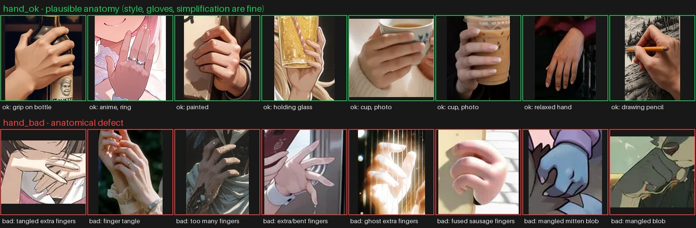
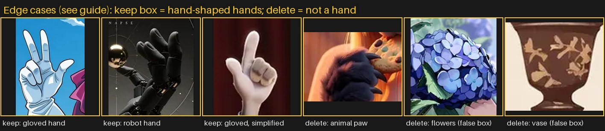

# Labeling guide: hands in AI-generated images

**Goal:** draw a box around every visible hand and say whether its anatomy is plausible (`hand_ok`) or broken
(`hand_bad`). The detector trained on these labels will later drive automatic inpainting of broken hands in ComfyUI.
Recall on `hand_bad` matters most there, but labels must stay **consistent**. When you hesitate, follow the rules
below, not your mood on the day.

Every image comes with **pre-annotated boxes**: all of them are `hand_ok`, produced by two YOLO hand detectors.
They are suggestions. Fix, delete, add and relabel them.

## 1. Classes

| class | meaning |
|---|---|
| `hand_ok` | The hand is anatomically plausible **for the drawing style**: the right number of fingers (counting the hidden ones), sensible joints, the fingers attached to a palm, a believable grip. |
| `hand_bad` | Any clear anatomical defect (see section 2). One clear defect is enough. |

Optional, only for `hand_bad`: tick one or more **defect types** (`extra_fingers`, `missing_fingers`, `fused_fingers`,
`broken_joint_or_wrist`, `mangled_blob`, `other`). These help the error analysis later. Skip them if you are in a hurry.

## 2. What counts as a defect (`hand_bad`)

- **Extra fingers:** six or more fingers on one hand, or two thumbs.
- **Missing fingers:** fewer than five fingers where the others **should be visible** given the pose. Fingers hidden behind an object or curled into a fist do **not** count as missing.
- **Fused or melted fingers:** fingers merge into each other or into the held object; the "sausage" or "clay" look; no separation where there should be one.
- **Broken joints or wrist:** a finger bending the wrong way, an impossible wrist twist, a hand attached to the wrong side of the arm, a thumb on the wrong side for left/right.
- **Mangled blob:** you cannot read the structure of the hand at all (a mitten-like lump, a tangle of fingers from two hands merged together).
- **Wrong scale or detached:** a hand clearly too large or small for the body, or floating without an arm.
- **Grip nonsense:** an object passes *through* the fingers or the fingers wrap around nothing (only when it is clearly visible).

Not defects (keep `hand_ok`):
- Stylisation: anime/cartoon hands with simplified knuckles, four-finger cartoon hands (Simpsons-style), thick outlines, no fingernails.
- Unusual but possible poses, foreshortening, motion blur, depth-of-field blur.
- Long or thin fingers in a painterly/anime style, as long as the count and joints are right.
- Rings, tattoos, nail polish, henna, dirt or paint on the hand.

**Rule of thumb:** count the fingers first, then check the joints, then check the grip. If you need more than about 10 s
to decide, use the "uncertain" rule in section 4.

## 3. Boxes

- **One box per hand**, from the fingertips to the wrist crease. Include the wrist joint, not the forearm.
- A hand partly hidden by an object: box only the **visible** part, plus the fingers you can see behind a transparent object.
- **Two hands clasped or overlapping** (praying, holding hands): one box per hand when you can separate them. If they are merged into one inseparable mass, draw one box covering both and label it `hand_bad` (that merge is itself a defect).
- **Tiny hands:** if the longest side of the hand is **below 24 px** in the image as shown (images are 512 px wide), **do not box it**, and delete the pre-box if there is one. Defects cannot be judged at that size.
- **Heavily cropped hands:** if less than about 1/3 of the hand is in the frame or visible, do not box it.
- Fix sloppy pre-boxes. Typical problems: a box covering the whole forearm, a box cutting off fingertips, and two boxes on the same hand (delete one).

## 4. Edge cases

| case | what to do |
|---|---|
| Gloves, gauntlets, mittens with fingers | Treat as hands. Judge the finger count and shape through the glove. |
| Robot, skeleton, or armoured hands with a human layout | Treat as hands, using the same rules. |
| Anthro or furry characters with human-like hands | Treat as hands. |
| Animal paws, claws, tentacles, bird feet | **Not hands.** Delete the box. |
| Feet and toes | **Not hands.** Delete the box. (This is the most common false positive.) |
| Hands in a painting or a poster inside the image, statues | Box only if large and clearly drawn; otherwise ignore. |
| Hand shapes in clouds, flowers, fabric folds, food | **Not hands.** Delete the box. |
| Very dark or silhouetted hands | Box if you can see the outline. Use `hand_ok` unless a defect is visible in the outline itself. |
| **Uncertain** (you honestly cannot tell) | Use `hand_ok` and keep moving. Do not invent defects. |
| Image is unreadable (heavy effects, collage, text-only) | Tick `skip_unclear` and delete all boxes. |
| Image looks unsafe or suggestive to you | Tick `skip_unsafe` and move on. It will be removed from the dataset. |

## 5. Consistency check

The pipeline re-shows **~120 images a week later**, with the same images and no boxes visible. Labelling them again
lets us measure *self-agreement* (box IoU and class agreement). This tells us how ambiguous the task is and is a
nice number for the README. Do not look up your previous answers.

## 6. Speed tips (Label Studio)

- `1` = hand_ok, `2` = hand_bad, then drag to draw. Click a pre-box and press `Backspace` to delete it.
- Use `Ctrl`+scroll to zoom into hands. Most defects are only visible at 2-3x zoom.
- Work in batches of about 250 images (about 40 minutes) and take breaks. Fatigue makes you miss defects.
- The task header shows `defect hint max`, a weak zero-shot CLIP score. In our visual check it reacted mostly to dark crops and hands holding phones,
  not to real defects. **Ignore it while labelling.** It is stored only to evaluate later whether it carries any signal.
