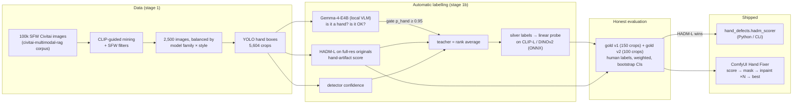

# Hand-defect detector for AI-generated images

Diffusion models still break hands: extra or fused fingers, twisted wrists, melted grips. This project asks a practical
question: **can broken hands in generated images be found automatically, without hand-labelling thousands of boxes, and
then fixed inside a ComfyUI pipeline?**

**Result, in short.** We built an automatic-labelling pipeline (VLM teacher → silver labels → small student) and tested it
honestly against two rounds of human labels. The best signal turned out to be an off-the-shelf research model,
**HADM-L** (a human-artifact detector), scored on detected hand boxes:

- **AUC 0.76 [95% CI 0.51–0.96]** on the independent gold round (75 hands, 8 broken);
- **0.72 [0.54–0.87]** pooled over both rounds (182 hands, 17 broken);
- 28–37% of broken hands caught at a 10% false-alarm rate.

Our own distilled student reaches only 0.59–0.61. So the shipped tool uses HADM-L as the hand-quality scorer, a
local VLM (Gemma) only as an offline hand/not-hand gate, and a **ComfyUI node pack** that masks suspicious hands and
keeps the best of N inpainting attempts. It is a triage tool, not a solved QC gate, and the numbers below say exactly how far it gets.


*Our ComfyUI nodes on a Kaggle T4: the scorer flags a hand (left), and Best-of-4 SD1.5 inpainting picks a candidate with lower P(bad) (right).*

## Pipeline



## Results

Every number is on human-labelled gold crops that were never used for training. Each crop has a sampling weight
(its stratum size divided by the crops drawn from that stratum), so the metrics describe the whole crop population.
95% CIs come from 2,000 label-stratified bootstrap resamples. With only 8–17 broken hands, CIs are wide; read the ranking, not the decimals.

**Gold v2: the honest headline.** 100 new crops, labelled after every modelling choice had been made: 75 judged
hands, 8 BAD. The round was enriched for likely-bad crops.

| score (BAD = positive) | AUC | AP (BAD) | recall @ 10% FPR |
|---|---|---|---|
| **HADM-L hand artifact (≥ 50% inside the hand region)** | **0.76 [0.51–0.96]** | **0.34** | 0.28 |
| v3 teacher: rank average of HADM + Gemma + detector conf | 0.65 [0.43–0.85] | 0.20 | 0.06 |
| CLIP-L/14 student (v3 silver labels) | 0.59 [0.33–0.85] | 0.22 | 0.24 |
| detector confidence | 0.54 | 0.15 | 0.04 |
| Gemma-4-E4B p(ok) alone | 0.52 | 0.16 | 0.01 |
| DINOv2-base student | 0.51 | 0.14 | 0.00 |
| *random* | 0.50 | 0.12 | 0.10 |

**Gold v1: optimistic for the v3 teacher.** 150 crops: 107 judged hands, 9 BAD. The v3 teacher was designed after
looking at this round, so its v1 number is optimistic.

| score | AUC |
|---|---|
| v3 teacher (HADM + Gemma + det) | 0.79 [0.66–0.91] (optimistic) |
| detector confidence / Gemma alone | 0.71 / 0.69 |
| CLIP-L student, v3 / v2 silver labels | 0.67 / 0.66 |
| HADM-L alone | 0.66 [0.39–0.87] |
| CountHallu finger counter / quality classifier (external) | 0.64 / 0.57 |

**Pooled v1 + v2.** 182 hands, 17 BAD; each round's weights are rescaled to its own sample size.

| score | AUC | AP (BAD) | recall @ 10% FPR |
|---|---|---|---|
| **HADM-L** | **0.72 [0.54–0.87]** | 0.33 | 0.37 |
| v3 teacher | 0.71 [0.58–0.84] | 0.25 | 0.19 |
| CLIP-L student (v3) | 0.61 [0.44–0.77] | 0.21 | 0.29 |
| Gemma / detector conf | 0.60 / 0.60 | 0.17 | 0.17–0.19 |

**Calibration.** Platt scaling on the pooled gold set gives `P(bad) = sigmoid(4.108·raw − 4.039)`. Leave-one-out ECE is
0.013 and Brier 0.086 ([`models/hadm_calibration.json`](models/hadm_calibration.json)). The base rate of broken hands is about 10%, so the
nodes use a default threshold of P(bad) ≥ 0.2, which corresponds to raw HADM ≥ ~0.65.

**The Gemma gate.** In gold v2, 7 of the 8 crops it rejected really are not hands, but 4 non-hands still passed it
with p_hand ≥ 0.98. It is used offline only, to clean the crop pool, and is not part of the shipped scorer.

## Lessons learned

1. **Silver cross-validation is not accuracy.** The CLIP-L student reproduced its teacher's silver labels with CV AUC
   0.90–0.96, yet scored 0.59–0.67 on human gold. A student can only be as good as its teacher, and the teacher was weak.
2. **Choosing a teacher on the test set leaks.** The fused v3 teacher looked like a clear win on gold v1 (0.79). It was
   picked *after* seeing v1, and on the fresh gold v2 it dropped to 0.65. Only the component that had not been tuned on v1,
   HADM alone, held up (0.66 → 0.76). A second, untouched gold round was the most valuable thing in the project.
3. **Frozen CLIP can't learn it.** Hand defects are local and geometric. A linear head on frozen CLIP-L or DINOv2
   embeddings did not pick up HADM's signal even when HADM was in the teacher (gold v1: 0.664 → 0.669). It mostly learned
   "small, blurry, unusual". Doing better would need a fine-tuned backbone on high-resolution crops, so we ship HADM itself.
4. **Enrichment by a weak score barely enriches.** Gold v2 drew 60 crops from the teacher's lowest 10%. Only 9% of
   them were BAD, against an estimated 12% overall: that tail is mostly stylized, gloved, robotic and skeletal hands that are fine.
5. **Averaging in near-chance signals hurts.** On gold v2, Gemma and detector confidence were near chance, and averaging
   them with HADM diluted it (0.76 → 0.65).

## External baselines

- **CountHallu** ([arXiv:2510.13080](https://arxiv.org/abs/2510.13080)): models trained on RealHand close-ups of SD hands.
  Its finger counter gets AUC ≤ 0.64 on our crops, and its quality classifier 0.57. The "bad if fingers ≠ 5" rule flags
  almost every real hand, because most hands are partly occluded.
- **HADM-L** ([arXiv:2411.13842](https://arxiv.org/abs/2411.13842), [code](https://github.com/wangkaihong/HADM)): a
  ViTDet / EVA-02-L Cascade R-CNN for artifacts on generated people. We ported it to torch 2.x without xformers or compiled
  detectron2 ops. It takes about 1.6 s per 1024 px image on a T4. Scored on our hand boxes, it is the best signal we found.

## Limitations

- **Small gold sets.** There are 17 broken hands in total, so the CIs span about ±0.2 AUC, and the calibration is approximate.
- **Failure modes:**
  - unusual but correct hands are flagged: gloves, robots, skeletons, heavy stylization, blur;
  - subtle finger-count errors on fists and grips are missed;
  - a hand the YOLO detector misses is never scored.
- **Domain.** The data is SFW Civitai images from 2025–2026 models (Krea 2, Illustrious, Flux, …). Other domains are untested.
- **The ComfyUI fixer was tested end-to-end on only 5 images** (see below). Whether Best-of-N picks hands that a human
  prefers is anecdotal: 1 clear success, 1 ambiguous case, and 1 where the inpaint dropped a held object. There is no
  before/after study on fresh generations.
- **Licensing.** HADM has no license file. Its code and weights are not redistributed here, and you fetch them from the authors.

## Use it

**Python / CLI** (`hand_defects/hadm_scorer.py`):

```bash
pip install torch torchvision ultralytics fvcore iopath "omegaconf>=2.1" "hydra-core>=1.1" pycocotools
python -m hand_defects.hadm_scorer img.jpg --models-dir ~/.cache/hand_fixer --download   # first run fetches ~5.8 GB
# {"image": "img.jpg", "hands": [{"box": [...], "det_conf": 0.80, "region": [...], "hadm_raw": 0.76, "p_bad": 0.29, "bad": true}]}
```

```python
from hand_defects.hadm_scorer import HADMHandScorer
scorer = HADMHandScorer("~/.cache/hand_fixer", device="cuda")
hands = scorer(rgb_uint8)            # list of Hand(box, det_conf, region, hadm_raw, p_bad, bad)
```

`--download` clones HADM at the pinned commit `d09f667`, and fetches the HADM-L weights (5.7 GB) from the authors' link and
the ADetailer `hand_yolov8s.pt`. HADM runs **unmodified**: the torch 2.x port is a set of runtime shims (xformers → SDPA,
stubs for training-only imports, a scoped `weights_only=False` load). No patch file and no compilation are needed.

**ComfyUI:** the node pack lives in [`comfyui_hand_fixer/`](comfyui_hand_fixer/), a separate repository. It provides
`Load Hand Defect Scorer`, `Hand Defect Scorer` (outputs a MASK of bad hands, a preview and a JSON of scores) and
`Hand Fix: Best-of-N Selector`, plus an example SD1.5-inpaint workflow. It was tested in headless ComfyUI on a Kaggle T4:
5 of 5 workflows ran, 3 of 5 human-labelled broken hands were flagged, and Best-of-N lowered P(bad) on all 3. See its
README for the visual examples, including the failures.

## Reproduce

```bash
python -m venv .venv && .venv/bin/pip install -r requirements.txt
# stage 1: data (01 runs in the civitai-multimodal-rag venv, which has the CLIP index)
#   scripts/01_select_candidates.py, 03_detect_candidates.py, 04_select_final.py, 05_preannotate.py (see docs/DETAILED_LOG.md)
# stage 1b: automatic labelling (details and resume notes: AUTO_LABEL_RUN.md)
.venv/bin/python autolabel/01_crop_all.py && .venv/bin/python autolabel/02_cheap_scores.py
bash autolabel/run_vlm.sh                                    # Gemma-4-E4B on CPU, resumable
python autolabel/09_hadm_kaggle/01_build_input.py --all      # then the private Kaggle kernel in kernel_all/ (~35 min, 2×T4)
python autolabel/09_hadm_kaggle/04_crop_scores.py
.venv/bin/python autolabel/04_fuse.py --teacher hadm_gemma_det && .venv/bin/python autolabel/05_silver_train.py
# evaluation on human gold
.venv/bin/python autolabel/07_ingest_eval.py --gold-dir gold_check_v2                 # honest round
.venv/bin/python autolabel/07_ingest_eval.py --gold-dir gold_check,gold_check_v2 --write-calibration
.venv/bin/python autolabel/11_gold_v2_analysis.py && .venv/bin/python autolabel/12_hadm_calibration.py
python -m pytest tests -q
```

GPU use for the whole project was about 53 minutes on Kaggle T4s:
- HADM on the gold images: 6.5 min;
- HADM on all 2,500 images: 34.5 min;
- the ComfyUI end-to-end test: 11.3 min.

Everything else ran on CPU.

The full chronological write-up is in [`docs/DETAILED_LOG.md`](docs/DETAILED_LOG.md). It covers the detector benchmark,
labelling guide, per-round tables, matching rules and failure analysis. Run notes are in [`AUTO_LABEL_RUN.md`](AUTO_LABEL_RUN.md).

## Data, credits and licenses

- **Images.** The images belong to their Civitai authors and are **not** redistributed; only the example renders in `docs/` are included.
  The corpus is the strict-SFW subset of [civitai-multimodal-rag](https://github.com/tablesizedogo/civitai-multimodal-rag).
- **HADM**, the main scorer: K. Wang, L. Zhang, J. Zhang, *Detecting Human Artifacts from Text-to-Image Models*,
  arXiv:2411.13842. The repository has no license file, so it is used via `git clone` plus the authors' weights link and nothing is vendored.
- **Hand detector:** [Bingsu/adetailer](https://huggingface.co/Bingsu/adetailer) `hand_yolov8s` (Apache-2.0), run with ultralytics (AGPL-3.0).
- **Gemma-4-E4B:** the gate and VLM teacher, under the Gemma terms of use.
- **OpenCLIP** ViT-L/14 `laion2b_s32b_b82k` and DINOv2: student backbones.
- **CountHallu:** the external baseline models.
- **This repository's code:** MIT.
