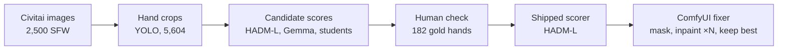
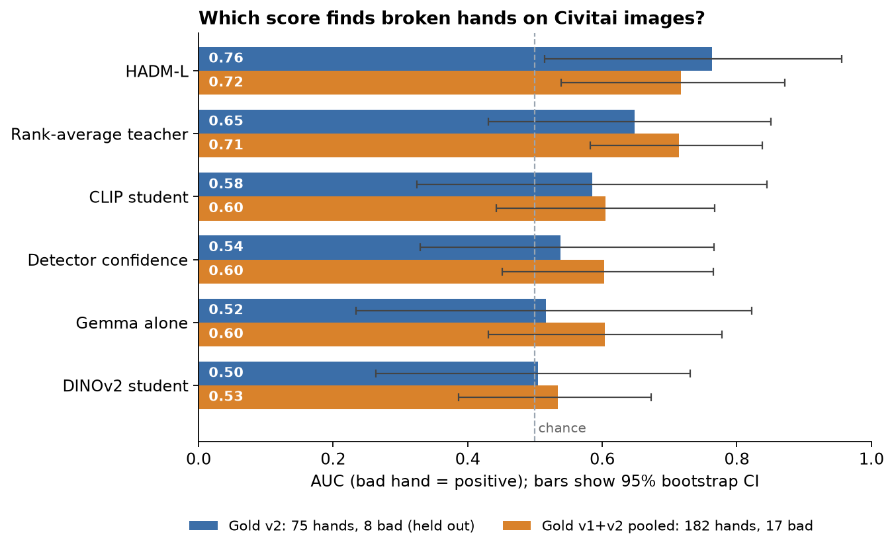
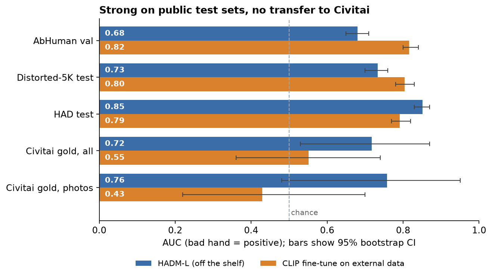
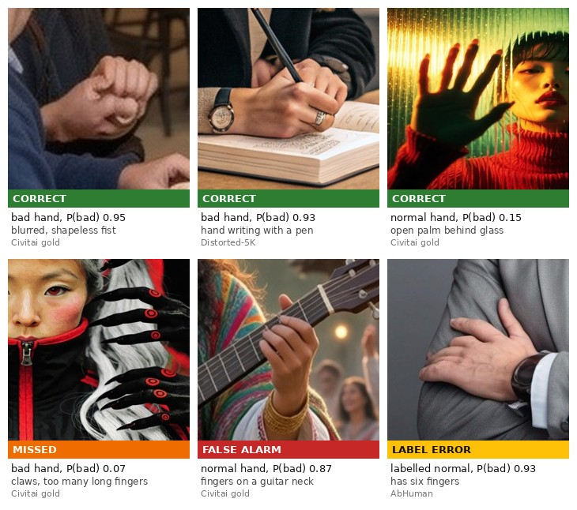

# Hand-defect detector for AI-generated images

Diffusion models still break hands: extra or fused fingers, twisted wrists, melted grips. This project finds broken
hands in generated images without hand-labelling thousands of boxes, and fixes them inside ComfyUI.

- **What ships:** a Python/CLI hand scorer built on the HADM-L artifact detector, and a ComfyUI node pack that masks
  suspicious hands and keeps the best of N inpainting attempts.
- **How well it works:** on 182 human-labelled Civitai hands (17 of them broken) it scores AUC 0.72 and AP 0.33;
  a random guess would get an AP of about 0.10. On the held-out second labelling round alone, AUC was 0.76.
  At a 10% false-alarm rate it catches 28–37% of broken hands. It is a triage tool, not a finished QC gate.
- **What was explored:** an automatic-labelling pipeline (VLM teacher, silver labels, small student) and, after
  release, a CLIP fine-tune on public datasets. Neither beat the off-the-shelf detector on Civitai images.


*ComfyUI nodes on a Kaggle T4: the scorer flags a hand (left); Best-of-4 SD1.5 inpainting picks the candidate with the lowest P(bad) (right).*

## How it works



2,500 images from a strict-SFW Civitai corpus, balanced by base model and style, went through a YOLO hand detector.
Several scorers were compared on two rounds of hand-labelled gold crops. HADM-L, used off the shelf, scored best and is
what ships, both as a Python scorer and inside the ComfyUI node pack.

## Results

Every score was tested on human-labelled Civitai hand crops that were never used for training.



| Model | Gold v2 | Gold v1 | Pooled |
|---|---|---|---|
| HADM-L | 0.76 | 0.65 | 0.72 |
| Rank-average teacher | 0.65 | 0.79 | 0.71 |
| CLIP student | 0.58 | 0.67 | 0.60 |
| Detector confidence | 0.54 | 0.71 | 0.60 |
| Gemma alone | 0.52 | 0.69 | 0.60 |
| DINOv2 student | 0.50 | 0.56 | 0.53 |
| Random baseline | 0.50 | 0.50 | 0.50 |

AUC, broken hand = positive class. Gold v2 is the main result.

1. **Gold v2:** 75 hands, 8 broken, labelled after every modelling choice was fixed. **Gold v1:** 107 hands, 9 broken;
   the teacher was designed after looking at this round, so its 0.79 is optimistic. **Pooled:** 182 hands, 17 broken.
2. Each crop carries a sampling weight so the metrics describe the whole crop population. 95% CIs come from 2,000
   label-stratified bootstrap resamples and are drawn in the chart. With 8–17 broken hands they span roughly ±0.2,
   e.g. HADM-L 0.51–0.96 on gold v2 and 0.54–0.87 pooled. Read the ranking, not the decimals.
3. HADM-L: the ViTDet / EVA-02 human-artifact detector of Wang et al., scored on our hand boxes. Rank-average teacher:
   rank average of HADM-L, Gemma and detector confidence. CLIP student and DINOv2 student: linear heads on frozen
   CLIP-L/14 and DINOv2-base embeddings, trained on the teacher's silver labels. Gemma alone: Gemma-4-E4B asked
   whether the hand looks correct. Detector confidence: the YOLO hand-detector score.
4. Source: `autolabel_data/gold_check_v2`, `gold_check` and `gold_check_combined` (`autolabel/07_ingest_eval.py`).

**Calibration.** Platt scaling on the pooled gold set gives `P(bad) = sigmoid(4.108·raw − 4.039)` (leave-one-out
ECE 0.013, Brier 0.086; [`models/hadm_calibration.json`](models/hadm_calibration.json)). About 10% of hands are broken,
so the nodes flag a hand at P(bad) ≥ 0.2, which is raw HADM ≥ ~0.65.

## Follow-up: fine-tuning CLIP on public datasets

The obvious next step was to train a better hand classifier without labelling more Civitai images by hand. I
fine-tuned the last four blocks of CLIP ViT-L/14 on about 54,000 labelled hands from three public datasets
(AbHuman, HAD and Distorted-5K). It beat HADM-L on two of the three public test sets, but on the Civitai gold
set it was no better than chance.

| Setting | Value |
|---|---|
| Model | CLIP ViT-L/14, OpenCLIP `laion2b_s32b_b82k` |
| Trained | last 4 of 24 blocks and a linear head |
| Data | 53,948 hands from AbHuman, HAD and Distorted-5K |
| Sampling | balanced by dataset and class |
| Loss and optimizer | binary cross-entropy, AdamW |
| Learning rate | 1e-5 blocks, 1e-3 head, cosine schedule |
| Batch and epochs | 64, 3 epochs, kept epoch 2 |
| Hardware | one Kaggle T4, about 34 min |

All settings, a pipeline diagram and the training curve are in
[the write-up](docs/experiments/clip_finetune_external_data.md#model-and-training).



I then tested four explanations on the Civitai gold set:

| Hypothesis | Verdict |
|---|---|
| The low gold score is small-sample noise | Confirmed |
| The model learned the generator or style, not the hand | Rejected |
| The public datasets define a bad hand differently | Partly |
| Gold crops differ in size and sharpness | Rejected |

1. Noise: the fine-tune's AUC on gold photos (0.43, 8 broken hands) sits inside the 0.25–0.75 band that random labels
   give. On all gold it is 0.55 and still indistinguishable from chance, while HADM-L is above chance (p = 0.012).
2. Generator shortcut: AUC within a single generator drops by only 0.03, the same as for HADM-L, and image style explains
   3% of the score variance.
3. Different notion: this is the main real cause. The model rates gloves, gauntlets, claws and fur as normal hands,
   and flags complex but correct grips (guitars, heart hands, folded palms). Without the atypical hands its photo AUC
   rises to 0.66, against 0.97 for HADM-L. Defect types were tagged by hand, one person, 5–16 hands per group.
4. Crop shift: gold hands are larger (median 126 px against 69–94 px) and two to three times sharper, but re-cropping,
   downscaling and blurring move the AUC only within the noise (0.51–0.61).

Where it works and where it fails, on held-out crops (flagged at P(bad) ≥ 0.83):



The last tile looked like a false alarm, but the hand has six fingers: the AbHuman label is wrong and the model was
right. We do not know how many other public labels are wrong, so the external AUC numbers carry that uncertainty.

**Takeaway.** Strong scores on public benchmarks did not carry over to the images this tool is meant for. The shipped
scorer stays HADM-L. A better student needs 60–100 labelled broken Civitai hands, atypical and complex-grip hands in
training, and resolution, blur and JPEG augmentations. Full write-up:
[`docs/experiments/clip_finetune_external_data.md`](docs/experiments/clip_finetune_external_data.md).

## Lessons learned

1. **Silver cross-validation is not accuracy.** The CLIP student matched its teacher's silver labels with CV AUC
   0.90–0.96, yet scored 0.58–0.67 on human gold. A student is only as good as its teacher.
2. **Choosing a teacher on the test set leaks.** The fused teacher looked best on gold v1 (0.79) because it was picked
   after seeing v1. On the untouched gold v2 it fell to 0.65, while HADM-L alone held up (0.65 → 0.76). The second gold
   round was the most valuable thing in the project.
3. **Frozen embeddings miss local geometry.** A linear head on frozen CLIP-L or DINOv2 did not pick up HADM's signal
   even with HADM in the teacher (gold v1: 0.664 → 0.669). It mostly learned "small, blurry, unusual".
4. **Enrichment by a weak score barely enriches.** Gold v2 drew 60 crops from the teacher's lowest 10%; only 9% of them
   were broken, against about 12% overall. That tail is mostly gloved, robotic, skeletal or stylised hands that are fine.
5. **Averaging in near-chance signals hurts.** On gold v2, adding Gemma and detector confidence to HADM-L diluted it
   (0.76 → 0.65).
6. **Public benchmarks are not the target domain.** See the follow-up above.

## Use it

Python / CLI (`hand_defects/hadm_scorer.py`):

```bash
pip install torch torchvision ultralytics fvcore iopath "omegaconf>=2.1" "hydra-core>=1.1" pycocotools
python -m hand_defects.hadm_scorer img.jpg --models-dir ~/.cache/hand_fixer --download   # first run fetches ~5.8 GB
# {"image": "img.jpg", "hands": [{"box": [...], "det_conf": 0.80, "region": [...], "hadm_raw": 0.76, "p_bad": 0.29, "bad": true}]}
```

```python
from hand_defects.hadm_scorer import HADMHandScorer
scorer = HADMHandScorer("~/.cache/hand_fixer", device="cuda")
hands = scorer(rgb_uint8)            # list of Hand(box, det_conf, region, hadm_raw, p_bad, bad)
```

`--download` clones HADM at the pinned commit `d09f667` and fetches the HADM-L weights (5.7 GB) from the authors' link
and the ADetailer `hand_yolov8s.pt`. HADM runs unmodified on torch 2.x through runtime shims (xformers → SDPA, stubs for
training-only imports, a scoped `weights_only=False` load); no patch file or compilation is needed. About 1.6 s per
1024 px image on a T4.

ComfyUI: the node pack is a separate repository, [ComfyUI-Hand-Fixer](https://github.com/tablesizedogo/ComfyUI-Hand-Fixer). It provides
`Load Hand Defect Scorer`, `Hand Defect Scorer` (mask of bad hands, preview, JSON scores) and
`Hand Fix: Best-of-N Selector`, plus an example SD1.5-inpaint workflow. In a headless end-to-end test on a Kaggle T4,
5 of 5 workflows ran, 3 of 5 human-labelled broken hands were flagged, and Best-of-N lowered P(bad) on all 3.

## Limitations

- **Small gold sets.** 17 broken hands in total, so CIs span about ±0.2 AUC and the calibration is approximate.
- **Known failure modes.** Unusual but correct hands (gloves, robots, skeletons, heavy stylisation, blur) get flagged;
  subtle finger-count errors on fists and grips are missed; a hand the YOLO detector misses is never scored.
- **Domain.** SFW Civitai images from 2025–2026 models (Krea 2, Illustrious, Flux and others). Other domains are untested.
- **The ComfyUI fixer was tested end to end on only 5 images:** 1 clear success, 1 ambiguous case, and 1 where the
  inpaint dropped a held object. There is no before/after study on fresh generations.

## Other baselines

- CountHallu ([arXiv:2510.13080](https://arxiv.org/abs/2510.13080)): its finger counter reaches AUC ≤ 0.64 on our
  gold v1 crops and its quality classifier 0.57. The "bad if fingers ≠ 5" rule flags almost every real hand, because
  most hands are partly occluded.
- CLIP fine-tune on public datasets: see the follow-up section.

## Reproduce

```bash
python -m venv .venv && .venv/bin/pip install -r requirements.txt
# data: scripts/01_select_candidates.py, 03_detect_candidates.py, 04_select_final.py, 05_preannotate.py
# automatic labelling (run and resume notes: docs/AUTO_LABEL_RUN.md)
.venv/bin/python autolabel/01_crop_all.py && .venv/bin/python autolabel/02_cheap_scores.py
bash autolabel/run_vlm.sh                                    # Gemma-4-E4B on CPU, resumable
python autolabel/09_hadm_kaggle/01_build_input.py --all      # then the private Kaggle kernel in kernel_all/ (~35 min, 2×T4)
python autolabel/09_hadm_kaggle/04_crop_scores.py
.venv/bin/python autolabel/04_fuse.py --teacher hadm_gemma_det && .venv/bin/python autolabel/05_silver_train.py
# evaluation on human gold
.venv/bin/python autolabel/07_ingest_eval.py --gold-dir gold_check_v2
.venv/bin/python autolabel/07_ingest_eval.py --gold-dir gold_check,gold_check_v2 --write-calibration
.venv/bin/python autolabel/11_gold_v2_analysis.py && .venv/bin/python autolabel/12_hadm_calibration.py
python scripts/make_doc_charts.py                            # README / docs charts
python -m pytest tests -q
```

The main project used about 53 minutes of Kaggle T4 time (HADM on gold 6.5 min, HADM on all 2,500 images 34.5 min,
ComfyUI test 11.3 min); everything else ran on CPU.

## Repository layout

| Path | Contents |
|---|---|
| `hand_defects/` | the shipped scorer (`hadm_scorer.py`) |
| `autolabel/` | automatic labelling, students, gold evaluation |
| `scripts/` | data selection, pre-annotation, chart generation |
| `models/` | calibration and small ONNX student heads |
| `docs/` | detailed log, labelling guide, experiment write-ups, figures |
| `tests/` | unit tests |

Further reading:
- [`docs/DETAILED_LOG.md`](docs/DETAILED_LOG.md): the full chronological write-up (detector benchmark, per-round tables,
  matching rules, failure analysis);
- [`docs/experiments/clip_finetune_external_data.md`](docs/experiments/clip_finetune_external_data.md): the follow-up experiment;
- [`docs/AUTO_LABEL_FEASIBILITY.md`](docs/AUTO_LABEL_FEASIBILITY.md) and [`docs/AUTO_LABEL_RUN.md`](docs/AUTO_LABEL_RUN.md): choosing and running the labelling pipeline;
- [`docs/LABELING_GUIDE.md`](docs/LABELING_GUIDE.md): rules used for the human gold labels.

## Data, credits and licences

- Images belong to their Civitai authors and are not redistributed; only the example renders and small gold crops
  in `docs/` are included. The corpus is the strict-SFW subset of
  [civitai-multimodal-rag](https://github.com/tablesizedogo/civitai-multimodal-rag).
- HADM, the main scorer: K. Wang, L. Zhang, J. Zhang, *Detecting Human Artifacts from Text-to-Image Models*,
  [arXiv:2411.13842](https://arxiv.org/abs/2411.13842), [code](https://github.com/wangkaihong/HADM). The repository has
  no licence file, so it is fetched with `git clone` plus the authors' weights link and nothing is vendored.
- Hand detector: [Bingsu/adetailer](https://huggingface.co/Bingsu/adetailer) `hand_yolov8s` (Apache-2.0), run with ultralytics (AGPL-3.0).
- Gemma-4-E4B: gate and VLM teacher, under the Gemma terms of use.
- OpenCLIP ViT-L/14 `laion2b_s32b_b82k` and DINOv2: student backbones.
- Public datasets used in the follow-up. Only five example crops from AbHuman and Distorted-5K are included, in the
  example galleries; HAD is reported as numbers only:
  [AbHuman / HumanRefiner](https://huggingface.co/datasets/Enderfga/HumanRefiner) (MIT),
  [Distorted-5K](https://huggingface.co/datasets/xgklndsgkl/Distorted-5K) (Apache-2.0),
  HAD from the [HADM repository](https://github.com/wangkaihong/HADM) (no licence file).
- CountHallu: external baseline models.
- This repository's code: MIT.
