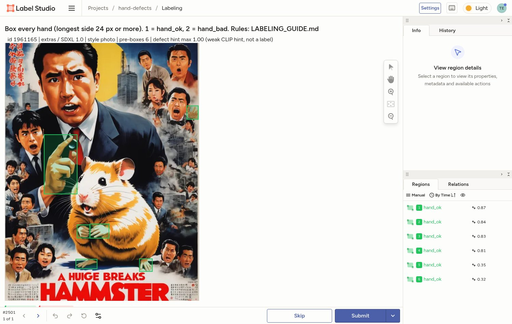

# Hand-defect detector for AI-generated images

> **Status: stage 1 (data) and stage 1b (automatic labeling) are done; the first honest check on a 150-crop user-labeled gold set shows the automatic teacher is still weak (AUC ≈ 0.66–0.69 for the teacher and the CLIP-L student, only 9 broken hands in the set, wide CIs).** See [Gold-check results](#gold-check-results-honest-metrics).

Diffusion models still break hands: extra or fused fingers, broken wrists, mangled blobs. This project builds a detector that
finds hands in generated images and classifies them as **`hand_ok`** or **`hand_bad`**. It ships as a **ComfyUI custom node** that
masks broken hands and sends them to inpainting automatically, which works as a quality-control step for generation pipelines.

It continues [civitai-multimodal-rag](https://github.com/tablesizedogo/civitai-multimodal-rag): the images come from the same
100k-image Civitai corpus (strict SFW), and candidate selection uses its CLIP index.

## Plan

| stage | what | status |
|---|---|---|
| 0. Problem setup | classes `hand_ok` / `hand_bad`, labeling guide, target metrics: mAP50 and **recall on `hand_bad`** (a missed defect costs more than a false alarm in QC) | done |
| 1. Data | CLIP-guided candidate mining → hand-detector screening → balanced selection of 2,500 images → pre-annotation | done |
| 1b. Automatic labeling | VLM teacher + detector + CLIP → silver labels → linear probe on CLIP-L / DINOv2 (ONNX) → 150-crop user gold check | done; gold metrics below, teacher needs improvement |
| 2. Training (Kaggle T4/P100) | zero-shot baseline (Grounding DINO "deformed hand"); YOLO11 vs RT-DETR; two-stage detector + crop classifier; learning curve at 250/500/1000/all labels; error analysis by base model and style | planned |
| 3. ComfyUI node | detect → dilated mask → inpaint with the same prompt, up to N retries; evaluate the share of defect-free images before/after on 200 fresh generations | planned |
| 4. Packaging | ONNX export (no PyTorch in the node), weights and labels on the HF Hub (no images), README with GIF | planned |

## Stage 1: data pipeline

```
100,167 SFW Civitai images (webp, 512 px)                       ← civitai-multimodal-rag corpus
  │ 60 CLIP text queries ("holding a cup", "praying hands", "anime character waving", …), top-900 each
  ▼ 20,684 candidates
  │ filters: clean_flags (junk/near-dups), EN+RU prompt blocklist, extra prompt terms, 3 CLIP zero-shot SFW filters
  ▼ 13,809 candidates
  │ hand_yolov8s screening: ≥1 hand with conf ≥ 0.35 and short side ≥ 40 px, ≤ 6 hands
  ▼ 8,949-image pool (fewer after the stricter risk filter)
  │ balanced by base-model family × style, ≤ 3 images per author, CLIP near-dup cos ≥ 0.92 removed,
  │ CLIP "fan-service" risk score ≤ 0.022 + 39 images removed by manual visual review
  ▼ 2,500 images → pre-annotation (YOLOv8s ∪ YOLOv9c, NMS) → 5,604 boxes, all `hand_ok`
```

**Selected images** (`data/selection_stats.json`):

| family | photo | anime | art | total |
|---|---:|---:|---:|---:|
| Krea 2 | 433 | 312 | 339 | 1,084 |
| Illustrious | 98 | 433 | 195 | 726 |
| Flux (all versions) | 211 | 46 | 141 | 398 |
| Other (Anima, Z-Image, SDXL, Pony, MOSS) | 78 | 146 | 68 | 292 |
| **total** | **820** | **937** | **743** | **2,500** |

Images come from 1,494 authors. Flux and the smaller families are under their quota (600/500) because of the
3-per-author cap and the SFW filters; the shortfall was filled with Krea 2. The style (photo/anime/art) is a CLIP zero-shot label.

### Pre-annotator benchmark

We ran the detectors on 48 images (16 photo, 16 anime, 16 art) on CPU. The GT is the union of all detectors' boxes,
checked visually; 7 ambiguous images were excluded, leaving 54 hands. Recall is therefore *relative to what at least
one detector found*.

| detector | s/img (CPU) | recall photo | recall anime | recall art | recall all | precision all |
|---|---:|---:|---:|---:|---:|---:|
| ADetailer `hand_yolov8n` @0.25 | 0.026 | 0.78 | 0.75 | 0.67 | 0.74 | 0.88 |
| ADetailer `hand_yolov8s` @0.25 | 0.038 | 0.91 | 0.75 | 0.80 | 0.83 | 0.94 |
| ADetailer `hand_yolov9c` @0.25 | 0.101 | 0.87 | 0.69 | 0.87 | 0.81 | 0.94 |
| MediaPipe Hands (landmarks → box) | 0.022 | 0.78 | 0.38 | 0.40 | 0.56 | 1.00 |
| Grounding DINO tiny, "a hand." @0.3 | 2.757 | 1.00 | 0.88 | 0.87 | 0.93 | 0.70 |
| **v8s @0.15 ∪ v9c @0.25 (NMS 0.4), chosen** | 0.14 | 0.96 | 0.94 | 1.00 | **0.96** | **0.86** |

MediaPipe fails on anime and art. Grounding DINO has the best single-model recall, but it is about 20× slower and
fires on whole people, feet and objects. The YOLO union gives nearly the same recall at about 0.14 s per image.

Weights: [Bingsu/adetailer](https://huggingface.co/Bingsu/adetailer) (`hand_yolov8s.pt`, `hand_yolov9c.pt`).

### Labeling

- Guide: [LABELING_GUIDE.md](LABELING_GUIDE.md) (classes, defect rules, edge cases, tiny-hand threshold of 24 px).
- Tooling: Label Studio (local files) or CVAT (COCO import). See [docs/LABELING_QUICKSTART.md](docs/LABELING_QUICKSTART.md).
- Pre-boxes in Label Studio (verified on a local Label Studio 1.23 instance: 2,500 tasks and 2,500 predictions imported, images served from local files):

  
- Pre-annotation overview (cyan = pre-box, number = detector confidence): [qa/qa_overview.jpg](qa/qa_overview.jpg)
- Self-agreement: 120 random images are relabeled from scratch about a week later.
- The train/val/test split will be made **by author** (and checked for prompt near-duplicates), so that series from one author
  do not leak into the test set.

## Reproduce

```bash
# 1a. candidates (runs in the civitai-multimodal-rag search venv: needs its CLIP index)
cd ../civitai-multimodal-rag/search && .venv/bin/python ../../hand_defects/scripts/01_select_candidates.py
# everything else uses this project's venv
python -m venv .venv && .venv/bin/pip install -r requirements.txt
.venv/bin/python scripts/02_benchmark.py         # detector benchmark (downloads weights into weights/)
.venv/bin/python scripts/03_detect_candidates.py hand_yolov8s.pt data/candidates.jsonl data/det_v8s.jsonl 0.15
.venv/bin/python scripts/04_select_final.py      # balanced selection
.venv/bin/python scripts/05_preannotate.py       # boxes + weak CLIP defect hint
.venv/bin/python scripts/07_qa_grids.py 0        # QA grids
.venv/bin/python scripts/08_guide_examples.py    # guide example sheets
.venv/bin/python scripts/06_package.py           # dist/hand_defects_labeling.zip
```

## Gold-check results (honest metrics)

**Gold set.** 150 crops, stratified by teacher-score decile and style, judged by the user (one pass, one annotator):
98 OK hands, **9 BAD hands**, 34 "not a hand", 9 "can't judge". OK-vs-BAD metrics use the **107 gold hands** and are re-weighted
by the sampling weights. 95% CIs come from 2,000 label-stratified bootstrap resamples. **With 9 positives the CIs are very wide:
one BAD crop moves recall by ~11 points, and no difference between the scores below is statistically significant.**
The models were trained on silver labels from 4,325 of the 5,604 crops (the VLM job was still running); gold crops are never used for training.

| score (P(ok); BAD = positive class) | AUC | AP (BAD) | recall BAD @ 5% FPR | recall BAD @ 10% FPR |
|---|---|---|---|---|
| Gemma-4-E4B alone | 0.69 [0.49–0.87] | 0.22 [0.11–0.53] | 0.23 [0.00–0.60] | 0.34 [0.00–0.70] |
| fused teacher (Gemma + detector conf + CLIP zero-shot, rank average) | 0.67 [0.46–0.86] | 0.37 [0.11–0.68] | 0.34 [0.00–0.70] | 0.34 [0.10–0.70] |
| **student: CLIP-L/14 linear probe (ONNX)** | **0.66 [0.44–0.85]** | 0.21 [0.10–0.50] | 0.23 [0.00–0.60] | 0.34 [0.00–0.70] |
| student: DINOv2-base linear probe (ONNX) | 0.51 [0.31–0.71] | 0.11 [0.07–0.27] | 0.11 [0.00–0.30] | 0.11 [0.00–0.30] |
| *reference: detector confidence alone* | 0.71 [0.53–0.87] | 0.25 [0.12–0.58] | 0.23 [0.00–0.60] | 0.23 [0.00–0.70] |
| *reference: random score* | 0.50 | 0.08 | 0.05 | 0.10 |

For comparison, the CLIP-L student agrees with its own silver labels at CV AUC 0.96. That number measures how well it copies
the teacher, not how well it finds broken hands. On real labels the teacher itself reaches only ≈ 0.67–0.69.

**Calibration.** The raw student probabilities are badly over-confident about BAD (ECE 0.32). Platt scaling on the gold hands,
evaluated leave-one-out, brings ECE to 0.01 [0.01–0.07] and Brier from 0.23 to 0.078. That is no better than always predicting the
base rate (Brier 0.077): after honest calibration the model's calibrated P(ok) spans only ≈ 0.74–0.98 (1st–99th percentile over all gated hands). Isotonic regression was worse
(ECE 0.05) with so few positives. The deployed calibrator is Platt, in `models/calibration.json`.

**"Not a hand" gate.** 34 of 150 gold crops were not hands (feet, armor, hair, animals, objects), versus 25 that the gate had
sampled as non-hands. Gemma's P(hand) separates them well (AUC 0.98), but the original threshold of 0.5 was too lax.

| gate | precision | recall | non-hands left among hands | OK hands dropped |
|---|---|---|---|---|
| P(hand) < 0.5 (before) | 0.92 | 0.65 | 12 (9.9% of passed crops) | 1 of 98 |
| **P(hand) < 0.95 (now)** | 0.89 | 0.91 | 3 (2.8%) | 3 of 98 |

The threshold was chosen on the same gold set, so the "now" row is somewhat optimistic. The gap is large, though:
9 of the 12 missed non-hands had P(hand) 0.71–0.92, while 95 of the 97 OK hands that passed the old gate had P(hand) ≥ 0.95. The stricter gate removed 159 crops,
including about a fifth of the old silver-BAD tail. AUC on hands stayed the same (0.661 → 0.664), so the gate cleans the data but
does not fix the teacher. Gating on detector confidence did not help.

**Failure modes (from the 9 BAD and the top false alarms):**
- **Small crops.** Source images are 512 px, and the median BAD crop is 90 px versus 112 px for OK. Crop size alone gives AUC 0.65,
  so part of the signal is "small and blurry", not anatomy.
- **Subtle defects on grips.** Wrong finger counts or fused fingers on a fist or grip (#20, #38, #118, #147) are ranked as clean
  by every score. #147, a photo-style hand holding a bag strap, is in the top 10% "most OK" for Gemma and both students.
- **Gloves and armor** (#8, #10, #30) get mixed results.
- **False alarms on stylized hands.** Cartoon four-finger hands, creature, robot and skeletal hands, and heavily occluded hands are
  flagged as broken. The teacher confuses "unusual" with "malformed".
- **DINOv2 features carry almost no defect signal here.** CLIP-L is the only usable student backbone.

### External baselines

Two ready-made hand-quality models from CountHallu ([arXiv:2510.13080](https://arxiv.org/abs/2510.13080)), trained on the RealHand
dataset of SD-generated close-up hands, were scored on the same 107 gold hands with the same weights and bootstrap
(`autolabel/08_eval_external.py`, full table in `autolabel_data/gold_check/eval_external.md`). Each model saw the original gold crop
(1.3× box) and a 2.0× context crop from the same 512-px image; the better variant is shown.

| score (BAD = positive class) | AUC | AP (BAD) | recall BAD @ 5% FPR | recall BAD @ 10% FPR |
|---|---|---|---|---|
| [quality classifier](https://huggingface.co/ShyFoo/CountHallu-quality_cls_model-RealHand) P(clean), MaxViT-S, Apache-2.0 (2.0× crop) | 0.57 [0.36–0.77] | 0.17 [0.08–0.46] | 0.13 [0.00–0.40] | 0.23 [0.00–0.50] |
| [finger counter](https://huggingface.co/ShyFoo/CountHallu-counting_model-RealHand) −\|n − 5\|, YOLO, AGPL-3.0 (2.0× crop) | 0.64 [0.46–0.81] | 0.14 [0.08–0.35] | 0.11 [0.00–0.30] | 0.11 [0.00–0.30] |
| finger counter, soft P(n = 5) from box confidences | 0.50 [0.30–0.67] | 0.09 [0.06–0.13] | 0.00 | 0.00 |
| *ours: CLIP-L/14 student (for comparison)* | 0.66 [0.44–0.85] | 0.21 [0.10–0.50] | 0.23 [0.00–0.60] | 0.34 [0.00–0.70] |

Neither transfers to Civitai hands. The quality classifier is near chance and, at its own 0.5 threshold, calls 61–77% of OK hands
"failed". The finger counter finds exactly 5 fingertips on only 1 of 98 OK hands, because most hands in real images are partly
occluded or seen from the side. So the paper's rule "bad if n ≠ 5" flags almost every hand. Its small AUC edge comes from BAD crops more often having 0 detected fingertips (4 of 9 versus 32 of 98 OK
at 2.0×), a "hard to read" signal rather than a real count. Both models expect frontal, open, full-frame hands. That supports the plan: a better teacher needs in-domain data.

**Bottom line.** The pipeline is a useful *triage* tool: sort crops, and at a 10% false-alarm rate about a third of broken hands
are caught. It is not yet an automatic QC gate. Next steps: (1) a stronger or ensembled teacher on upscaled crops, for example a
larger VLM, several prompts, or crops from full-resolution images; (2) a second gold round enriched with low-score crops (active
learning), because 9 positives are too few to tune anything; (3) optionally, real hand-artifact examples from HAD (research-only license).

## Data and licensing

The images belong to their Civitai authors and are **not** redistributed in this repository. `meta/images.jsonl` in the labeling
package links every image to its Civitai page. Labels will be published without the images.

## Results

*To be filled after stage 2.*

## Stage 1b: automatic labeling (no manual box labeling)

Manual labeling of 5,604 boxes was replaced by an automatic teacher → student pipeline. A local VLM (Gemma-4-E4B, CPU) gives a Yes/No/None judgment per crop. It is fused with the detector confidence and CLIP zero-shot, and the confident tails become silver labels for a linear probe on CLIP-L / DINOv2 embeddings (exported to ONNX). The user checks only ~150 stratified crops, which are used for calibration and an honest metric.
See [`AUTO_LABEL_FEASIBILITY.md`](AUTO_LABEL_FEASIBILITY.md) (method comparison on 40 hand-judged crops) and [`AUTO_LABEL_RUN.md`](AUTO_LABEL_RUN.md) (how to run/resume).
