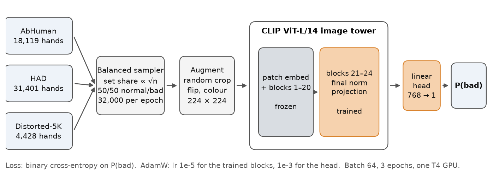
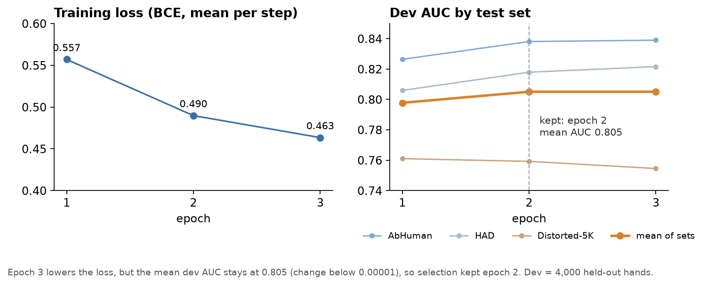
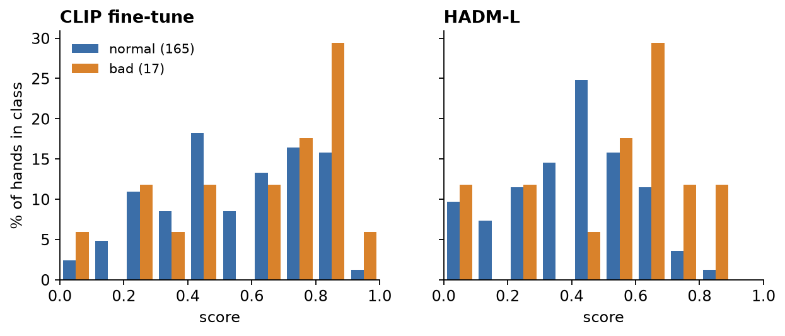
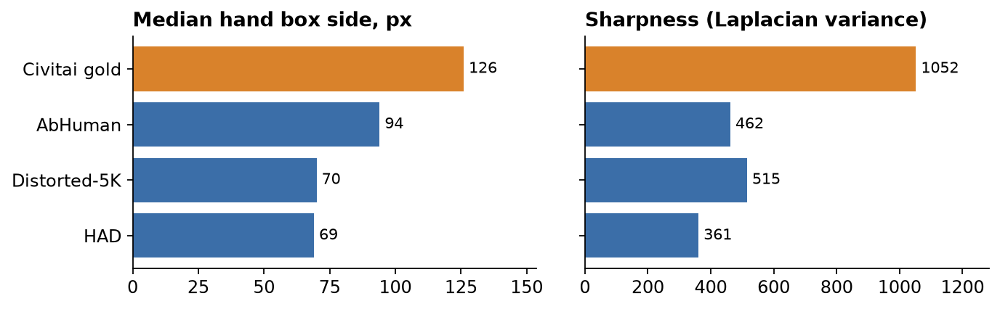
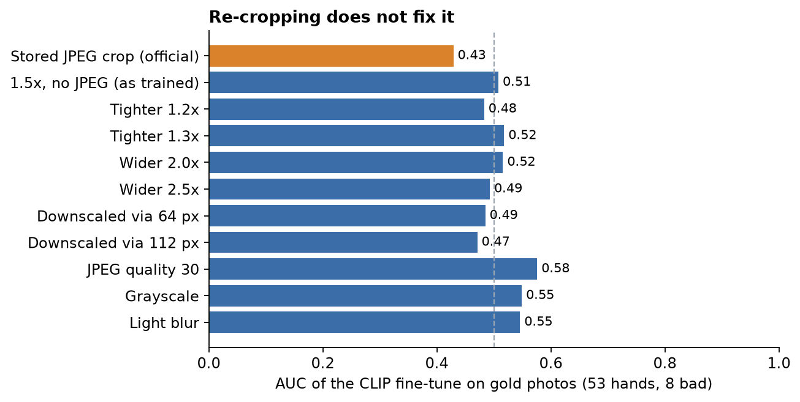
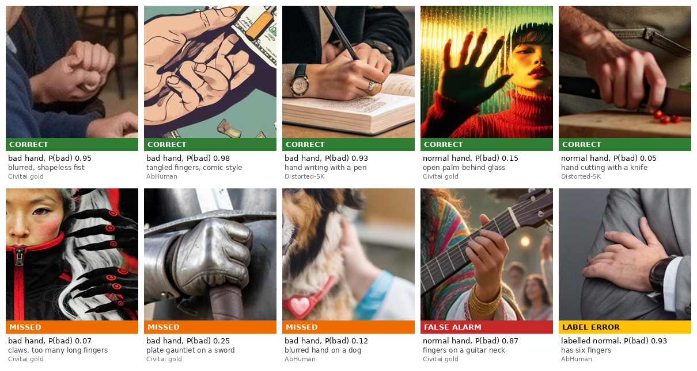

# Fine-tuning CLIP on public hand-defect datasets

Follow-up to the main project, October 2026. Question: can a hand classifier trained only on public labelled datasets
replace HADM-L on Civitai images, so that no more manual labelling is needed?

Short answer: no. The fine-tune beats HADM-L on two of three public test sets but is no better than chance on the
Civitai gold set. The main reason is that the public datasets teach a different idea of a "bad hand".

## Contents

- [Setup](#setup)
- [Results](#results)
- [Why it fails on Civitai](#why-it-fails-on-civitai)
- [Examples](#examples)
- [What would fix it](#what-would-fix-it)
- [Compute and reproducibility](#compute-and-reproducibility)

## Setup

### Datasets

| Dataset | Train images | Train OK hands | Train bad hands | Licence |
|---|---|---|---|---|
| AbHuman | 7,697 | 7,276 | 10,843 | MIT |
| HAD | 17,508 | 13,065 | 18,336 | none |
| Distorted-5K | 2,019 | 2,958 | 1,470 | Apache-2.0 |

1. AbHuman is distributed as [HumanRefiner](https://huggingface.co/datasets/Enderfga/HumanRefiner);
   [Distorted-5K](https://huggingface.co/datasets/xgklndsgkl/Distorted-5K) is on Hugging Face; HAD comes from the
   [HADM repository](https://github.com/wangkaihong/HADM). HAD has no licence file, so this repository contains HAD numbers only, no images.
2. Images were split by image with a fixed seed. The test sets are all of AbHuman val and the HAD and Distorted-5K
   images that HADM-L was also run on. 10% of the remaining images formed a dev set.
3. HADM-L was trained on HAD train, so HAD test is in-domain for both HADM-L and the fine-tune. Distorted-5K is in-domain
   for the fine-tune only.

**Content filter.** Every image of every set went through an NSFW filter before any hand was labelled or cropped:
Falconsai `nsfw_image_detection` P(nsfw) ≥ 0.2, or a CLIP-B/32 zero-shot "suggestive" score ≥ 0.5. The rule is
deliberately aggressive; on HAD train it dropped 4,997 of 33,374 images.

**Hand labels.** Hands were found with the same YOLO union as the main pipeline (ADetailer `hand_yolov8s` and
`hand_yolov9c`). A detected hand is bad if it matches an annotated defect box, OK if it overlaps no annotated
hand or arm box, and dropped otherwise. For Distorted-5K a hand is bad if at least 2 of 3 annotators placed a point
inside it, OK if none did. In AbHuman only SDXL images were used; its real photos were excluded to avoid a
real-vs-generated shortcut. Near-duplicate AbHuman val images (CLIP cosine ≥ 0.95 to a training image, 13 images)
were removed from evaluation.

**Crops.** Square, 1.5 times the hand box, resized to 256 px. Civitai gold hands were re-cut the same way from the
1024 px images that HADM-L saw.

### Model and training

| Setting | Value |
|---|---|
| Backbone | CLIP ViT-L/14 image tower, OpenCLIP weights `laion2b_s32b_b82k` |
| Trained | last 4 of 24 transformer blocks, final layer norm, output projection |
| Frozen | patch embedding and blocks 1–20 |
| Head | one linear layer, 768 → 1, sigmoid output P(bad) |
| Input | square crop 1.5× the hand box, stored at 256 px, fed at 224 × 224 |
| Loss | binary cross-entropy |
| Optimizer | AdamW, weight decay 0.05 |
| Learning rate | 1e-5 trained blocks, 1e-3 head |
| Schedule | 100-step linear warm-up, cosine decay to zero |
| Precision | fp16 mixed precision |
| Batch size | 64 |
| Epoch | 32,000 sampled crops, 500 steps |
| Epochs | 3, kept epoch 2 |
| Sampler | weighted, with replacement |
| Set shares | AbHuman 0.36, HAD 0.47, Distorted-5K 0.18 |
| Class balance | 50% normal, 50% bad within each set |
| Train hands | 53,948 |
| Dev hands | 4,000 |
| Augmentation | random resized crop, horizontal flip, colour jitter |
| Test-time | mean of the crop and its mirror image |
| Seed | 0 |
| Hardware | Kaggle, one NVIDIA Tesla T4 |
| Training time | about 34 min, 11 min per epoch |
| Libraries | Python 3.13, PyTorch, torchvision, OpenCLIP, scikit-learn, Pillow |

1. Trained parameters: everything else in the image tower has `requires_grad = False`. The text tower is not used.
2. Input: crops were cut from images downscaled to at most 1024 px and saved as JPEG (quality 92). Evaluation resizes
   the 256 px crop to 224 px without further cropping.
3. Schedule: the learning-rate factor is `min(1, step/100) × 0.5 × (1 + cos(π · step/1500))`, 1,500 steps in total.
   Mixed precision uses `torch.autocast` with a gradient scaler. No class weighting in the loss, since the sampler
   already balances classes.
4. Epochs: numbered from 1 here. The kept checkpoint is the second epoch, stored as `ckpt_ep1.pt` because the script
   counts from 0. Selection used the mean of the three per-set dev AUCs; see the curve below.
5. Sampler: the share of each set is proportional to the square root of its hand count. Each epoch draws 32,000 crops,
   about 0.6 of the training hands, so the model saw 96,000 samples in total.
6. Train hands per set: AbHuman 7,276 normal and 10,843 bad; HAD 13,065 normal and 18,336 bad; Distorted-5K 2,958
   normal and 1,470 bad. The dev set is 4,000 hands sampled from 5,948 held-out hands (10% of training images, split
   by image and stratified by set). Dev scoring used no mirror averaging.
7. Augmentation: random resized crop to 224 px with scale 0.7–1.0 and aspect ratio 0.9–1.1 (bicubic), flip with
   probability 0.5, colour jitter 0.2 for brightness, contrast and saturation and 0.02 for hue. Normalisation uses the
   CLIP mean and standard deviation.
8. Time: about 19 ms per training image. Downloading the datasets and cutting crops took another 7 min; the run reached
   checkpoint selection after 41 min. The training notebook stopped while reloading the checkpoint (newer PyTorch
   versions default to `weights_only=True` in `torch.load`), so the test sets were scored by a second notebook from the
   saved epoch-2 checkpoint, 7 min on the same GPU type.
9. Libraries: versions were installed at run time and not logged. OpenCLIP came from `pip install open_clip_torch`
   (latest release at the time); the Kaggle image's PyTorch was used as is.

Loss kept falling in the third epoch, but the mean dev AUC did not move (0.8051 after epoch 2, 0.8050 after epoch 3),
and Distorted-5K dev AUC declined slightly from the first epoch on. Training longer would have fitted the public sets
more closely without a sign of better generalisation.

### Evaluation

AUC, with bad hands as the positive class. Public sets use an image-cluster bootstrap (1,000 resamples). The Civitai
gold set uses the main project's protocol: sampling weights per crop and a label-stratified bootstrap
(2,000 resamples). The failure analysis below adds 5,000 bootstrap resamples and 10,000-permutation tests.

## Results

| Test set | HADM-L | CLIP fine-tune | AbHuman-only fine-tune | Frozen CLIP head | Frozen DINOv2 head |
|---|---|---|---|---|---|
| AbHuman val | 0.68 | 0.82 | 0.80 | 0.77 | 0.75 |
| Distorted-5K test | 0.73 | 0.80 | 0.73 | 0.70 | 0.68 |
| HAD test | 0.85 | 0.79 | 0.71 | 0.69 | 0.67 |
| Civitai gold, all | 0.72 | 0.55 | 0.51 | 0.42 | 0.58 |
| Civitai gold v2 | 0.76 | 0.55 | 0.54 | 0.39 | 0.63 |
| Civitai gold, photos | 0.76 | 0.43 | 0.20 | 0.35 | 0.36 |
| Civitai gold, non-photo | 0.73 | 0.65 | 0.70 | 0.52 | 0.70 |

AUC, bad hand = positive class.

1. Sample sizes. AbHuman val: 1,563 hands (752 bad) on the images HADM-L was run on; on all 6,658 AbHuman val hands the
   fine-tune scores 0.82 as well. Distorted-5K test: 1,627 hands (751 bad). HAD test: 1,509 hands (757 bad).
   Civitai gold: 182 hands (17 bad); v2 75 (8); photos 53 (8); non-photo 129 (9).
2. 95% CIs on the public sets are about ±0.02–0.03. On the gold set they are wide: the fine-tune 0.36–0.74 and
   HADM-L 0.53–0.87 on all gold; 0.22–0.70 and 0.48–0.95 on photos.
3. Models. CLIP fine-tune: the model described above. AbHuman-only fine-tune: the same recipe on 14,000 AbHuman hands,
   2 epochs. Frozen CLIP head and Frozen DINOv2 head: logistic regression on frozen CLIP-L/14 and DINOv2-base embeddings,
   trained on AbHuman.
4. The Civitai CLIP student from the main project scores 0.40–0.42 on the three public test sets, below chance.
   Civitai and public-dataset labels disagree in both directions.
5. The HADM-L gold CIs here differ slightly from the main README (0.53–0.87 against 0.54–0.87) because the bootstrap was
   re-run; the point estimates are identical.
6. Source: `10_eval.py --split` (private experiment folder), `eval_ft3/eval.md`.

Two more observations:

- At a 10% false-alarm rate the fine-tune catches 42–46% of bad hands on the public sets, but only 12% on the gold set,
  against 37% for HADM-L.
- Per HAD generator, HADM-L against the fine-tune: SDXL 0.85 vs 0.78, Midjourney 0.69 vs 0.69, DALL·E 3 0.75 vs 0.77,
  DALL·E 2 1.00 vs 0.94.

## Why it fails on Civitai

Four hypotheses were tested on the 182 gold hands.

| Hypothesis | Verdict |
|---|---|
| H1. The low gold score is small-sample noise | Confirmed |
| H2. The model learned the generator or style, not the hand | Rejected |
| H3. The public datasets define a bad hand differently | Partly |
| H4. Gold crops differ in size and sharpness | Rejected |

1. H2 is "mostly rejected": the HAD data is skewed by generator, but the model does not exploit it more than HADM-L does.
2. H3 is the main real cause, but the defect-type tags behind it were assigned by eye by one person.
3. H4: the shift is real; it just does not explain the failure.

### H1: small-sample noise

| Gold slice | Hands | Bad | CLIP fine-tune | HADM-L | Gap |
|---|---|---|---|---|---|
| All | 182 | 17 | 0.55 | 0.72 | +0.17 |
| Photos | 53 | 8 | 0.43 | 0.76 | +0.33 |
| Non-photo | 129 | 9 | 0.65 | 0.73 | +0.08 |
| Anime | 70 | 4 | 0.54 | 0.45 | −0.08 |
| Art | 59 | 5 | 0.75 | 0.88 | +0.14 |

Weighted AUC. Gap = HADM-L minus the fine-tune.

1. Because of the sampling weights, the 17 bad hands carry about as much information as 12 unweighted ones
   (effective sample size 11.8).
2. 95% CIs on all gold: fine-tune 0.36–0.74, HADM-L 0.54–0.87, gap −0.02 to +0.35. On photos: 0.22–0.69, 0.48–0.95,
   gap about 0 to +0.57.
3. Anime and art slices have 4–5 bad hands each and prove very little.

What the tests show:

- With shuffled labels, AUC on the photo slice falls in 0.25–0.75 in 95% of permutations (0.33–0.67 on all gold).
  0.43 is inside that band: the fine-tune is indistinguishable from guessing on photos, but "worse than chance" cannot
  be claimed either.
- HADM-L is above chance on all gold (p = 0.012) and on photos (p = 0.047). The fine-tune is not (p = 0.57 and 0.59).
- The gap is close to significant but not quite: p = 0.09 on all gold, 0.06 on photos. HADM-L is probably better; by
  how much these data cannot say.
- Saving the same crops without JPEG compression moves the fine-tune's photo AUC from 0.43 to 0.51, another sign that
  the exact number is noise.

The score distributions show the problem more clearly than the AUC. The fine-tune gives many normal hands scores of
0.6–0.9, so bad hands drown among them. HADM-L rarely scores a normal hand above 0.7.

### H2: generator or style shortcut

In HAD the share of bad hands varies a lot by generator (test set: DALL·E 2 82%, SDXL 64%, DALL·E 3 55%,
Midjourney 22%). The model could have learned "looks like DALL·E 2" instead of anatomy. HAD was used for numbers only.

- Within a single generator the fine-tune's AUC is 0.76 against 0.79 pooled; HADM-L drops the same 0.03 (0.82 against 0.85).
- Predicting the generator from the score alone works at 32% accuracy for the fine-tune and 42% for HADM-L (chance 25%).
- On HAD DALL·E 2, the generator with the most bad hands, normal hands get the lowest mean score (0.15), the opposite of
  a shortcut.
- On gold, image style explains 2.8% of the fine-tune's score variance (8.3% for HADM-L). Brightness correlates weakly
  with the score (ρ = 0.21), but brightness alone predicts the label at AUC 0.54.
- A linear probe on the fine-tune's features predicts gold style at 71% accuracy, against 67% for frozen CLIP
  (chance 33%). Style is present in the features, as in any vision model, and fine-tuning barely amplified it.

### H3: a different notion of a bad hand

Every bad gold hand, and 30 bad hands from the AbHuman and Distorted-5K test sets, was tagged by eye as gross (extra or
fused fingers, shapeless mass) or subtle (wrong bend, joint or grip). Atypical hands (gloves, armour, claws, fur, clay)
were marked separately. The table shows each group's mean percentile among normal gold hands: 90 means the model finds
the hand more suspicious than 90% of normal hands.

| Group | Hands | CLIP fine-tune | HADM-L |
|---|---|---|---|
| Gold, gross defects | 7 | 72 | 66 |
| Gold, subtle defects | 10 | 55 | 73 |
| Gold, atypical hands | 5 | 39 | 43 |
| Gold, ordinary bare hands | 12 | 72 | 81 |
| Public sets, gross defects | 16 | 81 | 69 |
| Public sets, subtle defects | 14 | 77 | 62 |

Mean percentile of the score among normal gold hands. Groups overlap: atypical and bare are a second split of the same 17 gold hands.

- On public data the fine-tune catches subtle defects better than HADM-L (6 flags against 0 at 10% false alarms). On
  gold it is the reverse (3 against 5). A subtle defect in the public sets usually looks like a blurry low-resolution
  mess; on Civitai it is a sharp, well-drawn hand with wrong anatomy.
- Atypical hands are almost absent from training (1 of the 30 sampled public bad hands). On gold they are 5 of 17 bad
  hands and 4 of the 8 bad photo hands. The fine-tune gives them percentile 39: it has learned that a hand that is not
  bare skin is normal.
- 2 of the 8 bad "photo" hands are actually a painting and a cartoon, so the photo slice itself is mixed.
- Without the atypical bad hands (49 hands, 4 bad) the fine-tune's photo AUC rises to 0.66, against 0.97 for HADM-L.
  The gap remains, but it rests on 4 examples.
- The false alarms fit the same story: complex grips (guitar necks, strings, interlocked fingers, heart hands, folded
  palms) look like defects to the model.

### H4: crop size and sharpness

Gold hands are larger and sharper than the training hands.

All 182 gold hands were re-cut in several ways and re-scored on CPU. If framing or sharpness were the cause, some
setting would lift the AUC clearly.

- All settings give weighted AUC 0.51–0.61 on all gold and 0.43–0.58 on photos, well inside the ±0.2 CI.
- Settings that make gold look more like training data (blur, heavy JPEG, grayscale) help slightly, by 0.02–0.04 on all
  gold. That hints the model is not used to sharp crops, but it is within noise.
- The score is fragile: re-saving the same crop without JPEG shifts a hand's score by 0.045 on average (more than 0.1
  for 10% of hands).

### Gold slices

| Slice | Hands | Bad | CLIP fine-tune | HADM-L |
|---|---|---|---|---|
| Small hands, under 101 px | 61 | 8 | 0.77 | 0.77 |
| Large hands, 159 px and over | 61 | 3 | 0.21 | 0.60 |

Weighted AUC.

1. On the 26 hands where HADM-L was wrong (9 bad), the fine-tune scores 0.30: hands that are hard for HADM-L are hard
   for the fine-tune too.
2. The large-hand slice has 3 bad hands. It agrees with H4 but proves nothing.

## Examples

Where the CLIP fine-tune works and where it fails. Ten hand crops: five from the Civitai gold set, three from AbHuman
val and two from Distorted-5K test, all from the held-out test data. Each tile shows the true label, the fine-tune's
P(bad) and the verdict: 5 correct, 3 missed, 1 false alarm and 1 label error. A hand counts as flagged at P(bad) ≥ 0.83,
the fine-tune's 10% false-alarm point on gold; every example sits clearly on one side of that line.

- Correct: clear deformations are caught on all three sources, and ordinary hands in simple poses get low scores.
- Missed: atypical hands such as claws and a plate gauntlet (5 of the 17 bad gold hands are atypical), and a blurred
  hand at the edge of an AbHuman image. All three score below 0.25.
- False alarm: a complex but correct grip, fingers on a guitar neck.
- Label error: the AbHuman hand resting on a forearm looked like a false alarm, but on review it has six fingers. The
  dataset label is wrong and the model was right. We do not know how many other labels in the public datasets are
  wrong, so the external AUC numbers should be read with that in mind.

1. Crops are cut exactly as for scoring: square, 1.5× the hand box, 256 px. Descriptions are short notes from a visual
   review, not dataset annotations. True labels come from the datasets, except for the tile marked as a label error.
2. Every crop and its source image passed the same content filter as the training data (Falconsai P(nsfw) < 0.2 and
   CLIP-B/32 "suggestive" < 0.5) and a visual check. No HAD images are shown.
3. The gallery is built by [`scripts/make_doc_gallery.py`](../../scripts/make_doc_gallery.py); the filter check is
   [`scripts/check_gallery_sfw.py`](../../scripts/check_gallery_sfw.py). Both need the local experiment data.

## What would fix it

1. Do not read much into the 0.43. The reliable finding is that the fine-tune is not yet better than chance on gold
   and HADM-L is. Comparing models needs 60–100 labelled bad Civitai hands instead of 17, which would roughly halve the CIs.
2. Add atypical hands (gloves, armour, robotic and animal hands) to training, labelled both bad and normal.
3. Add normal hands in complex grips (instruments, interlocked fingers, gestures) to reduce false alarms.
4. Bring training closer to Civitai: more large, sharp crops, fewer upscaled tiny hands, and resolution, blur and JPEG
   augmentations so that re-saving a file does not move the score.
5. Add some labelled Civitai-like images to training, for example part of the gold set in cross-validation.
6. Until then, keep HADM-L as the primary signal and use the fine-tune at most as a second opinion, for example on small
   hands, where the two are equal.

## Compute and reproducibility

- All training and scoring ran in private Kaggle notebooks on a T4. Data preparation, fine-tuning and scoring for the
  final model took about 1.2 GPU hours; the whole follow-up used 3.9 GPU hours. The gold scoring and the failure analysis
  ran on CPU.
- External images were downloaded inside Kaggle from the public sources and are not stored in this repository, apart
  from the five AbHuman and Distorted-5K example crops in the gallery.
- The experiment code lives in a private folder outside this repository and is not published yet; the charts can be
  rebuilt from the numbers in [`scripts/make_doc_charts.py`](../../scripts/make_doc_charts.py).
